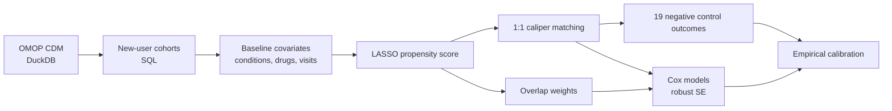
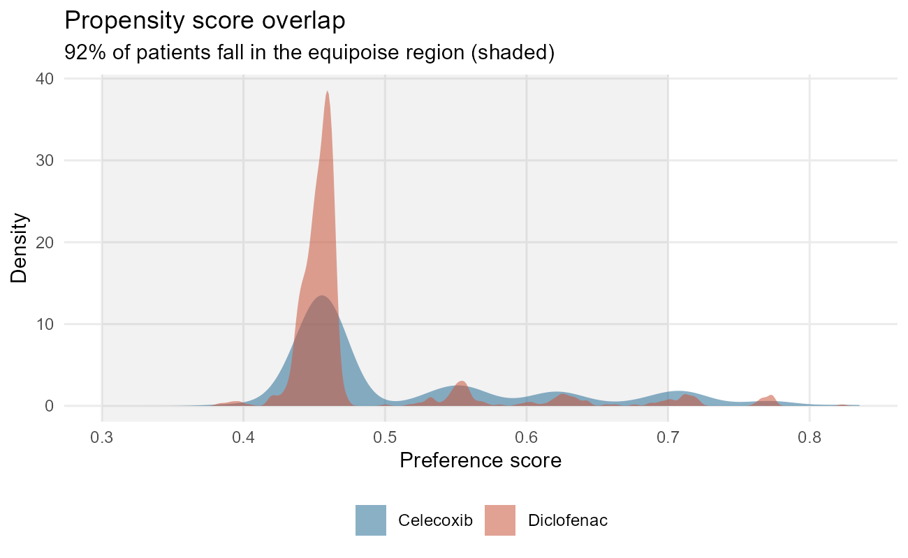
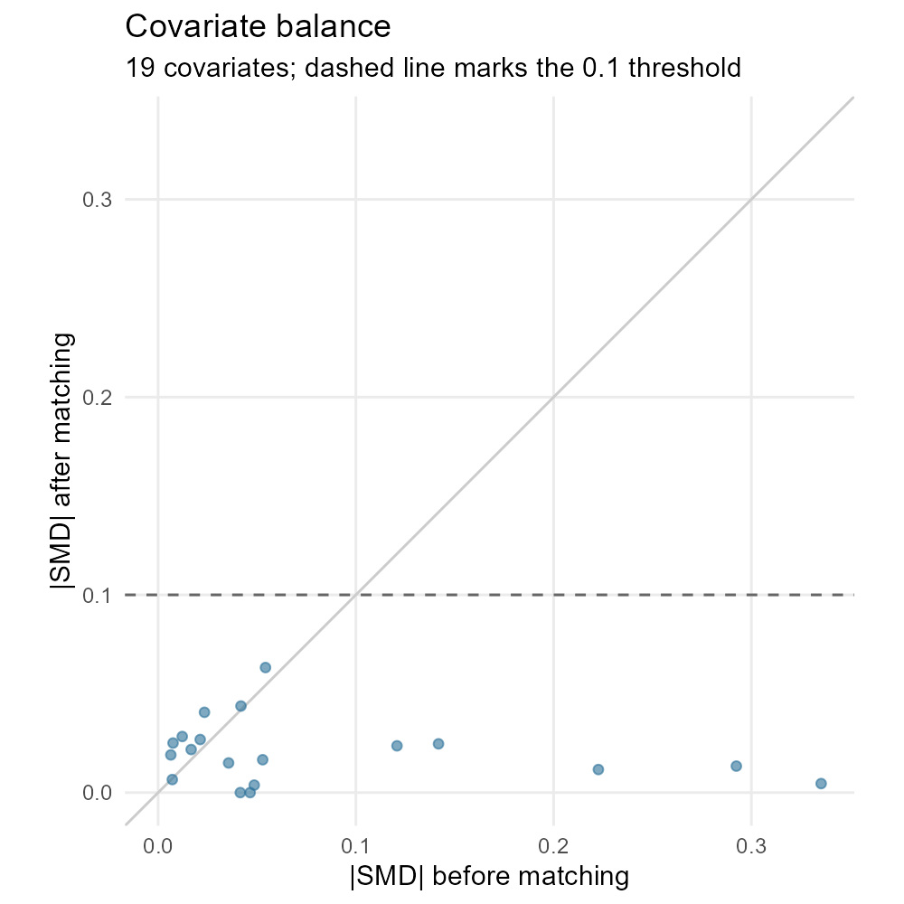
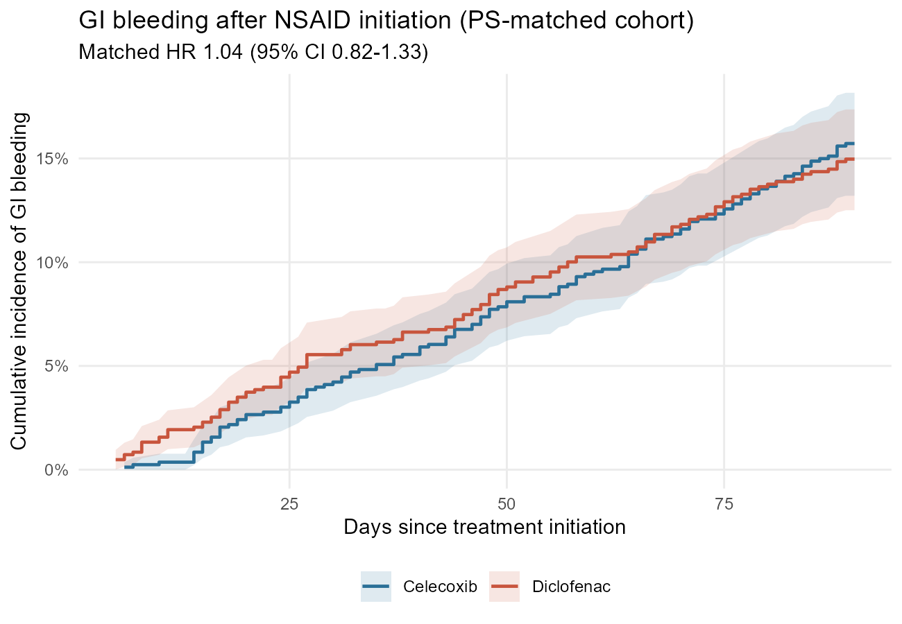
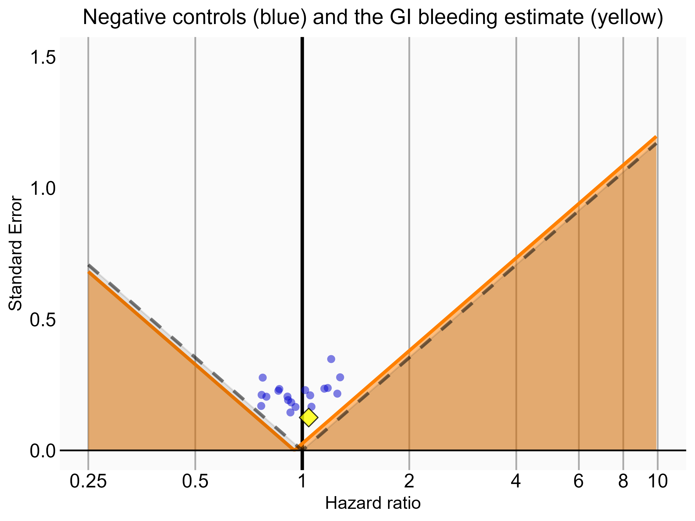

# Celecoxib vs diclofenac and GI bleeding: a new-user cohort study in OMOP

An end-to-end comparative safety study on an OMOP Common Data Model database. It uses an active-comparator, new-user design with large-scale propensity scores, PS matching, overlap weighting, negative control outcomes, and empirical calibration. These are the methods used in real-world evidence and pharmacoepidemiology studies of claims and EHR data.

> **Data note.** The study runs on [Eunomia GiBleed](https://github.com/OHDSI/EunomiaDatasets), a **synthetic** OMOP CDM v5.3 dataset of about 2,700 simulated patients published by OHDSI for training. The results show the pipeline working. They are **not clinical evidence** about either drug. Patient-level data never leave `data/` (git-ignored). Only aggregate tables and figures are committed, with small-cell suppression (counts under 11 masked) applied as if this were a real data use agreement.

## Question

Among adults starting an NSAID, does starting **celecoxib** (a COX-2 selective inhibitor) carry a different risk of **gastrointestinal bleeding** than starting **diclofenac** (a non-selective NSAID)?

## Design: target trial emulation

| Protocol element | Target trial | Emulation in OMOP data |
|---|---|---|
| Eligibility | Adults with no prior GI bleeding who have never used either drug | First-ever exposure to either ingredient; at least 365 days of prior observation; age 18 or older; no GI bleed on or before index; people exposed to both drugs excluded |
| Treatment strategies | Start celecoxib vs start diclofenac | New users identified at the ingredient level through `CONCEPT_ANCESTOR` |
| Assignment | Randomized | Emulated with a LASSO propensity score on demographics plus data-driven condition, drug, and utilization covariates from the prior 365 days |
| Time zero | Randomization | First dispensing (index date) |
| Follow-up | Day 1 to day 90 | Day 1 to day 90, censored at end of observation or death. Exposure end dates in this source are unusable (end = start), so follow-up is a fixed window rather than on-treatment |
| Outcome | GI bleeding | First `CONDITION_OCCURRENCE` of gastrointestinal hemorrhage (concept 192671) or any descendant concept |
| Causal contrast | Intention-to-treat | Observational analog of the ITT effect among diclofenac-like patients (1:1 matching, ATC) and among patients in equipoise (overlap weights, ATO) |



## Results

### Cohorts

| Step | Celecoxib | Diclofenac |
|---|---:|---:|
| First exposure to either drug | 1,844 | 850 |
| Index date within an observation period | 1,800 | 830 |
| All other criteria (washout, age, single drug, no prior GI bleed) | 1,800 | 830 |
| **1:1 PS-matched** | **830** | **830** |

### Confounding by indication, and removing it

Before adjustment, celecoxib users more often had GI conditions such as diverticular disease (18.8% vs 7.6%, SMD 0.34), colon polyps (17.3% vs 7.7%), and esophagitis (10.1% vs 4.3%). This is the classic **channeling** pattern: prescribers steer patients at higher GI risk toward COX-2 selective drugs, which makes celecoxib look more dangerous in a crude comparison.

The propensity model used 19 covariates, and LASSO retained 10. 92% of patients fell in clinical equipoise (preference score 0.3–0.7). After matching, every covariate had |SMD| < 0.1 (largest 0.063). After overlap weighting, the largest was 0.043.

<p align="center">
  
  
</p>

### Hazard ratios, celecoxib vs diclofenac

| Analysis (days 1–90) | Events (celecoxib / diclofenac) | HR (95% CI) |
|---|---|---|
| Crude | 355 / 124 | 1.35 (1.10–1.65) |
| **PS-matched 1:1 (primary)** | **130 / 124** | **1.04 (0.82–1.33)** |
| Overlap-weighted | 355 / 124 | 1.17 (0.95–1.44) |
| PS-matched, empirically calibrated | | 1.10 (0.86–1.40) |

The crude 35% excess risk disappears once confounding by GI history is addressed. In this synthetic population there is no evidence of a difference between the drugs.

<p align="center"></p>

**Sensitivity analyses** ([`results/hazard_ratios.csv`](results/hazard_ratios.csv), [`forest_plot.png`](results/forest_plot.png)):
- **Days 1–30:** matched HR 0.75 (0.48–1.17). This window is shorter and less precise, but it points the same way.
- **Day 1 to end of observation:** identical to the primary estimate. Every GI bleed in this dataset occurs within 90 days of index, so a longer window adds person-time but no events.

### Residual bias checks

**Negative controls.** I re-ran the matched analysis for 19 outcomes neither drug should cause: sprains, fractures, lacerations, burns, and common infections. Their estimates center close to the null (mean HR 0.95), with negligible spread. That suggests little systematic error beyond random noise. Calibrating the primary estimate against this null distribution shifts it slightly, to 1.10 (0.86–1.40), calibrated p = 0.46.

<p align="center"></p>

**E-value.** An unmeasured confounder associated with both treatment choice and GI bleeding by a risk ratio of 1.20 could fully explain the point estimate. Because the confidence interval already includes 1, the E-value for the interval is 1.

## Repository structure

```
├── run_all.R                  # runs the whole study
├── R/
│   ├── config.R               # concept IDs, windows, thresholds, negative controls
│   ├── utils.R                # DB connection, SQL templating, SMD, Cox wrapper, cell suppression
│   ├── 01_load_omop.R         # download Eunomia and load it into DuckDB
│   ├── 02_build_cohorts.R     # new-user cohorts and attrition table
│   ├── 03_covariates.R        # baseline covariate matrix
│   ├── 04_propensity_score.R  # LASSO PS, equipoise, matching, overlap weights, balance, Table 1
│   ├── 05_outcome_models.R    # Cox models, sensitivity windows, KM curve, E-value
│   └── 06_negative_controls.R # negative controls and empirical calibration
├── sql/                       # parameterized OMOP SQL (cohorts, covariates, time-at-risk)
├── results/                   # aggregate outputs only (committed)
└── data/                      # patient-level data (git-ignored)
```

## Reproduce

Requires R 4.5 or later. No Java or database server is needed; DuckDB runs in-process.

```r
install.packages("renv")
renv::restore()      # installs the package versions in renv.lock
source("run_all.R")  # downloads the data (~7 MB) and reproduces results/ in under a minute
```

Results are deterministic: the random seeds, row order, and column order are all fixed.

## Design choices and limitations

- **Why an active comparator?** Comparing two drugs used for the same indication (osteoarthritis here) reduces confounding by indication and healthy-user bias, compared with using non-users as the reference.
- **Why new users?** Prevalent users have already survived early treatment, so studying them hides early adverse events. A new-user design also anchors covariates before treatment starts.
- **Matching vs weighting.** 1:1 matching is the primary analysis because it is transparent and common in regulatory-facing RWE. Overlap weighting keeps all 2,630 patients and serves as a robustness check. The two estimates differ modestly (1.04 vs 1.17) because they target different populations.
- **Exposure duration.** Drug end dates in this source equal start dates, so an on-treatment analysis isn't possible. With real claims data, I would build drug eras with a grace period and run an on-treatment analysis alongside the ITT analysis.
- **Synthetic data.** Eunomia's simulated covariate structure is thin: only 19 covariates pass the 1% prevalence filter, and visit records are sparse. A real study would have hundreds to thousands of covariates.
- **Relationship to OHDSI tools.** The design mirrors OHDSI's [CohortMethod](https://ohdsi.github.io/CohortMethod/). Here it is written out step by step in SQL and R so that every design decision is visible.

## Author

**Wajeeha Umer, MPhil**, PhD candidate in Environmental Health Sciences (Epidemiology), UC Irvine · [Google Scholar](https://scholar.google.com/citations?user=sd-iHqkAAAAJ&hl=en&oi=ao)
